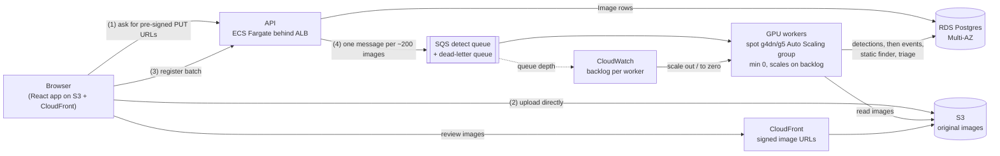

# Cloud design: running CamTrap Lite at TrapTagger scale on AWS

*Design only. Nothing here is implemented; the local version runs with docker-compose.*

**Target:** about 100 million images a year. That is only about 3 images/s on average, but
the load arrives in bursts: a field team returns and uploads a season's SD cards, millions
of images in a day. So the design has to scale up quickly and cost almost nothing when
idle.

## Components

| Local version | AWS | Why |
|---|---|---|
| `LocalStorage` (Docker volume) | **S3**, with browser uploads via **pre-signed URLs** | Image bytes never pass through the API, so the API stays small and cheap. |
| `DbQueue` (Postgres `SKIP LOCKED`) | **SQS** + dead-letter queue (`maxReceiveCount = 3`) | Managed, effectively unlimited throughput. Its visibility timeout plays the role of our lease, and the DLQ replaces our `failed` status after 3 attempts. |
| Postgres container | **RDS Postgres** (Multi-AZ) | Same schema and Alembic migrations, plus backups and failover. |
| Worker container on CPU | **Spot GPU instances** (g4dn.xlarge / g5.xlarge) in an Auto Scaling group, or **AWS Batch** with a spot compute environment | Detection is the only heavy step, and it is ideal for spot: idempotent and retryable. |
| API container | **ECS Fargate** behind an ALB | Stateless and small; 2 tasks are enough. |
| Images streamed by the API | **CloudFront** with signed URLs, plus review-size thumbnails (about 1280 px WebP, roughly 150 KB) | Faster review page, and much less data transfer than 1–3 MB originals. |

## How the interfaces make the switch small

All file and queue access already goes through two small abstract classes, so the move is
mostly **two new classes** chosen by configuration:

- `S3Storage(Storage)`: `put` → `upload_fileobj`, `open_read` → `get_object()["Body"]`,
  `exists` → `head_object`, `delete` → `delete_object`. Plus one new method,
  `url_for(key)`, for pre-signed/CloudFront URLs, so the API redirects instead of
  streaming bytes.
- `SqsQueue(JobQueue)`: `enqueue` → `send_message`; `claim` →
  `receive_message(WaitTimeSeconds=20)`; `complete` → `delete_message`; `fail` →
  `change_message_visibility(0)`, which lets SQS redrive to the DLQ after 3 receives.
  `QueuedJob.id` becomes the receipt handle, a string.

Routers, the worker loop, triage and the importer don't change. Two smaller changes:

- **EXIF reading moves into the worker**, which reads the image anyway, because uploads no
  longer pass through the API.
- **Per-camera post-processing becomes its own small job.** The worker that finishes a
  camera's last batch queues it, with a Postgres advisory lock per camera, so two workers
  never regroup the same camera at once.

## Scaling GPU workers

- **Scale on backlog per instance** (the target-tracking pattern AWS recommends for SQS):
  `ApproximateNumberOfMessagesVisible / running workers`, with a target of, say, 5
  messages (about 1,000 images) per worker.
- **Minimum capacity 0.** With an empty queue the fleet scales to zero, so idle cost is
  zero. Cold start is about 2–3 minutes (instance boot plus a model load of about 15 s),
  which is fine for batch work.
- **Spot interruptions are harmless:** on the 2-minute warning the worker stops claiming. An
  unfinished message reappears after its visibility timeout, and `save_detections`
  *replaces* an image's detections, so reprocessing is safe. A mixed instance policy
  (g4dn, g5 and others across several availability zones) keeps spot capacity available.
- **Keep the GPU busy.** Each message carries about 200 images. The worker downloads and
  decodes the next images in background threads while the GPU runs batched inference
  (MegaDetector's `generate_detections_one_batch`). Without this pipelining a GPU spends
  much of its time waiting on S3 and JPEG decoding.

## Rough cost

These are planning estimates; prices change. **Assumption to verify:** about 10 images/s per
NVIDIA T4 (g4dn.xlarge) for MDv5a including decoding. Confirm with
`scripts/evaluate.py --benchmark 200` on the instance before committing to a budget. For
comparison, this project measured 0.13 images/s on a laptop CPU, about 75× slower.

| | Per 1M images | Per 100M images/year |
|---|---:|---:|
| GPU time at 10 img/s | 28 GPU-hours | 2,800 GPU-hours |
| g4dn.xlarge on-demand (about $0.53/h) | about $15 | about $1,500 |
| g4dn.xlarge spot (typically 60–70% cheaper) | about $5 | about $500 |
| S3 Standard, 1 MB/image (about $0.023 per GB-month) | about $23/month | about $2,300/month for each year's 100 TB |

What this shows:

- **Detection is cheap; storage is not.** A year of GPU time costs less than one month of
  storing that year's images in S3 Standard. The main cost lever is lifecycle rules: move
  originals to S3 Glacier Instant Retrieval (about 5× cheaper) after review, and keep
  thumbnails hot.
- **Spot and batching matter** because they make GPU cost almost irrelevant. Spot cuts the
  hourly price by about 3×. Batching (images per message, and batched inference on the GPU)
  keeps utilisation high, so the fleet is paid for actual work, not waiting.
- **Scale-to-zero** matters more than instance choice, because the load is bursty. An
  always-on GPU (about $4,600/year on-demand) would cost 3× the actual detection work.

## What stays the same

- Triage thresholds, static clusters and human review work exactly as locally.
- The offline batch path keeps working: a partner can run MegaDetector on their own GPU or
  in Colab and upload the batch-output JSON, and `import_md_results` loads it without using
  any of our GPU time.
